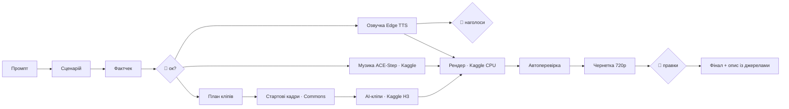

# prompt-to-video

**Один промпт → готове вертикальне відео (Reels / Shorts), майже без вашого комп'ютера і без грошей.**
Claude Code лише оркеструє; сценарій і фактчек пишуть моделі, озвучку дає Edge TTS, музику, AI-кліпи й рендер виконує безкоштовний GPU на Kaggle.

> *English summary:* a field-tested recipe and scripts that turn one prompt into a finished 9:16 explainer video (Ukrainian narration, subtitles with
> per-word highlight, unique AI clips for every script fragment, generated music) using only free tools: Kaggle GPU (MiniMax H3 image-to-video, ACE-Step music, CPU render),
> Edge TTS, Wikimedia Commons start frames. Claude Code is the orchestrator. Docs are in Ukrainian; scripts are language-agnostic.

## Результат, на якому це перевірено
Ролик «Чим забезпечена валюта» — 96 с, 1080×1920, 21 унікальний AI-кліп (по 2–3 на кожен з 9 кадрів), голос, музика, субтитри, −14 LUFS.
Підхід порівняно зі стоковим футажем: **унікальні кліпи зі стартових кадрів, максимально прив'язаних до змісту фрагмента, суттєво виграли**.
Вся робота людини — ≈ 15 хв: промпт, затвердження сценарію, вибір голосу/наголосів, затвердження музики, правки.

## Один промпт (шаблон)
```
Зроби навчальне відео для Reels/Shorts за рецептом docs/03-step-by-step.md.
Тема: […]. Аудиторія: […]. Мова й голос: українська, упевнений чоловічий. Музика: [спокійна|тривожна].
Тривалість: до 100 с, склейки кожні 2–3 с. Обов'язкові факти: […]. Чого уникати: […].
Візуал: унікальні AI-кліпи під кожен фрагмент; стартові кадри лише з суспільного надбання/CC.
Спершу покажи сценарій по таймінгах і чекай «так». Чернетки — 720p; у кінці — звіт токенів і джерел.
```
Як зробити його сильним — [docs/02-the-prompt.md](docs/02-the-prompt.md).

## Як це працює



## З чого почати
1. **Людині:** прочитайте [docs/01-accounts-and-install.md](docs/01-accounts-and-install.md) (акаунти, Kaggle з верифікацією телефону).
2. Створіть теку проєкту: `py pipeline/new_project.py projects/my-video` і `cd projects/my-video`.
3. **Своєму Claude Code:** «Розгорни все за інструкцією `docs/01-accounts-and-install.md`, потім зроби перше відео за `docs/03-step-by-step.md`.»
4. Повна покрокова інструкція — [docs/03-step-by-step.md](docs/03-step-by-step.md) (14 кроків: хто, що, команди, перевірки).

## Карта репозиторію
| Що | Де |
|---|---|
| Акаунти, встановлення, режими | [docs/01-accounts-and-install.md](docs/01-accounts-and-install.md) |
| Промпт і як його покращити | [docs/02-the-prompt.md](docs/02-the-prompt.md) |
| **Покрокова інструкція** | [docs/03-step-by-step.md](docs/03-step-by-step.md) |
| Готові брифи для агентів | [docs/04-agent-briefs.md](docs/04-agent-briefs.md) |
| Якість і автоперевірка | [docs/05-quality-and-qa.md](docs/05-quality-and-qa.md) |
| Пастки (з реальних збоїв) | [docs/06-pitfalls.md](docs/06-pitfalls.md) |
| «Одна кнопка» в Telegram | [docs/07-telegram-button.md](docs/07-telegram-button.md) |
| Ліцензії й етика | [docs/08-licensing.md](docs/08-licensing.md) |
| Скрипти конвеєра | [pipeline/](pipeline/) |
| Ядро Kaggle для image-to-video | [kernels/video_h3/](kernels/video_h3/) |
| Приклади (сценарій, план кліпів, промпти музики) | [examples/money/](examples/money/) |

## Чесний статус
| Крок | Статус |
|---|---|
| Озвучка Edge TTS зі словником вимови, слоти за межами слів | ✅ перевірено |
| Музика ACE-Step на Kaggle (лише інструментал) | ✅ |
| Стартові кадри з Commons, огляд кадрів Qwen на Kaggle | ✅ |
| AI-кліпи MiniMax H3 на Kaggle (ядро) | ✅ ядро перевірене в бою; виконавці `clip_runner.py`/`clip_queue.py` у цьому репозиторії — 🧪 (перший запуск на вас) |
| Рендер і автоперевірка на Kaggle (`build2.py`, `qa.py`) | ✅ |
| Українська пісня з вокалом | ❌ ACE-Step не підходить; див. пастки |
| Кнопка в Telegram | 🧪 описано принципи |

Вартість першого ролика: GPU Kaggle ≈ 8 год із безкоштовних ~30 год/тиждень; гроші — 0. Єдине застереження — комерційна ліцензія голосу Edge TTS (див. [docs/08-licensing.md](docs/08-licensing.md)).

## Ліцензія
Код і документація — MIT ([LICENSE](LICENSE)). Моделі, ваги й сервіси мають власні умови: [docs/08-licensing.md](docs/08-licensing.md).
