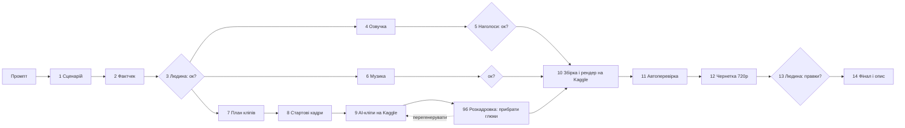

# Крок за кроком: від промпта до готового відео

Усі команди виконуються **з теки проєкту** (одне відео = одна тека): `py new_project.py projects/my-video`, далі `cd projects/my-video`.
`py` = Python 3.12+ (на Linux/macOS `python3`). Скрипти читають `shots.json`, `lexicon.json`, `audio/` зі своєї теки; робочі файли лежать у `work/`.
Позначки: ✅ перевірено на практиці · 🧪 написано за перевіреним зразком, наскрізно ще не прогнано тут.
**Хто виконує:** Claude Code лише пише брифи, запускає й перевіряє. Людина — на кроках 3, 5, 6 і 13 (див. колонку «Людина»).

## Карта процесу



## Крок 0. Один раз: акаунти й інструменти
Див. [01-accounts-and-install.md](01-accounts-and-install.md). Без нього далі не йдіть: потрібні Python, пакети, Kaggle (з верифікованим телефоном).

## Крок 1. Сценарій  ✅
- **Що:** 9–10 кадрів сценарію, кожен 18–28 слів, **усі числа й роки словами**, без абревіатур і латиниці, без дитячих прикладів;
  до кожного кадру — короткий напис великими літерами (3–4 слова).
- **Хто:** сильна модель за бриф з [04-agent-briefs.md](04-agent-briefs.md) (розділ «Сценарій»).
- **Результат:** `shots.json` за зразком [examples/money/shots.example.json](../examples/money/shots.example.json) (у теці проєкту це `shots.json`)
  (поля `id`, `text`, `label`, для першого кадру `kind: "title"` і `sublabel`).
- **Перевірка:** кожен кадр у межах 18–28 слів; у тексті немає цифр і абревіатур (`grep -P "\d" ` має бути порожнім для поля `text`).

## Крок 2. Фактчек  ✅
- Друга модель (іншого сімейства, ніж автор) перевіряє **кожне** твердження: «так / неточно / хибно + поправка» і шукає русизми й кальки.
  Бриф — у [04-agent-briefs.md](04-agent-briefs.md). Правки вносить Claude Code.
- Модель без веб-пошуку позначає факти як непідтверджені — для дат і чисел потрібне джерело (веб-дослідження окремим агентом).

## Крок 3. 👤 Затвердження сценарію
Покажіть людині таблицю «час → текст → напис → що на екрані». Без «так» далі не йдіть: переробка після озвучки й кліпів коштує годин GPU.

## Крок 4. Озвучка  ✅
```
py tts.py            # читає shots.json, пише audio/S*.mp3 + audio/S*.json, перераховує start/dur слотів
```
- Голос `uk-UA-OstapNeural` (Edge TTS, безкоштовно, без ключа), темп підбирається автоматично (найповільніший із +6/+12/+18 %, що вміщає текст у ліміт тривалості), `pitch -4Hz` для упевненості.
- Слоти кадрів рахуються за **реальними межами слів**, а не за довжиною mp3 (у mp3 є тиша на початку й у кінці).
- Результат: `shots.json` з `start`/`dur`, `audio/*.json` з часом кожного слова (для субтитрів).
- **Перевірка:** у виводі кожен слот ≥ тривалості мовлення + 0,35 с; суми збігаються з бажаною тривалістю.

## Крок 5. 👤 Наголоси  ✅
1. Надішліть людині прев'ю всієї озвучки (mp3). Людина називає слова з хибним наголосом.
2. Для кожного слова додайте у `lexicon.json` **альтернативне написання лише для озвучки**, напр. `{"фіатні": "фі-атні"}`.
   Знак наголосу (U+0301) Edge TTS виконує ненадійно — не покладайтеся на нього.
3. Якщо не ясно, яке написання правильне — згенеруйте 5 варіантів слова підряд і дайте людині обрати номер на слух.
4. `py tts.py` знову. Субтитри лишаються з правильним написанням (словник змінює лише озвучку).

## Крок 6. Музика  ✅ (Kaggle GPU, ≈25 хв)
```
mkdir work/music_in && cp examples/money/music_calm.json work/music_in/music.json     # або music_tense.json
py kaggle_job.py --name pipeline-music --script kernel_music.py --data work/music_in --gpu --timeout-min 75 --out work/music_out
```
- Модель ACE-Step v1 (Apache-2.0) — **лише інструментал**: вокал українською непридатний. Опис настрою англійською в `music.json` (`prompt`, `seconds`).
- Результат: `work/music_out/music.mp3`; скопіюйте в `music/` і впишіть шлях у `shots.json` → `"music": "music/…mp3"`.
- 👤 Людина слухає й затверджує (спокійна/тривожна/динамічна). Зерно змінюється за потреби (`MUSIC_SEED`).

## Крок 7. План кліпів  ✅
Для кожного кадру сценарію складіть 2–3 «заготовки»: що саме має бути видно (англійською), пошуковий запит до Wikimedia Commons
і **опис руху** для AI. Формат — [examples/money/plan.json](../examples/money/plan.json):
```json
{"id": "S2c", "shot": "S2", "q": "Royal Exchange London 1844", "subj": "19th-century exchange interior",
 "prompt": "The old engraving comes alive: merchants gesture in the hall, subtle push-in. Keep faces stable, no morphing, no text."}
```
Правила стартових кадрів: **суспільне надбання або CC** (без чужих водяних знаків); максимально прив'язані до змісту фрагмента (подія,
місце, об'єкт); краще архівні й предметні кадри, ніж «абстракція». У промпті руху: повільний рух камери, «keep … stable, no morphing, no text».

## Крок 8. Стартові кадри  ✅
```
py ai_prep.py work/ai_clips      # у теці work/ai_clips має лежати plan.json
```
Скрипт шукає зображення на Commons (`commons_fetch.py`: лише PD/CC0/CC BY, висота ≥ 600 px), робить кадр 768×1344
(широке зображення стає «карткою» на розмитому тлі), записує `plan_resolved.json` (з джерелом і ліцензією кожного кадру)
і контактний аркуш `start_frames_sheet.jpg`. Кадри, що не знайшлися, — перепишіть запит і запустіть знову (готові пропускаються).

## Крок 9. AI-кліпи на Kaggle  ✅ для ядра, 🧪 для цього виконавця (≈22 хв GPU на кліп)
```
py clip_queue.py --plan work/ai_clips/plan_resolved.json --frames work/ai_clips --out work/ai_clips
```
- Один запуск Kaggle = один кліп 5 с (MiniMax H3 image-to-video, T4). 20 кліпів ≈ 7–8 год GPU; квота Kaggle ≈ 30 год/тиждень.
- Запускайте **окремо від терміналу/сесії** (на Windows `Win32_Process.Create`, на Linux `nohup`/`systemd-run`) — довгі задачі гинуть разом із сесією.
- Перший запуск тягне ≈38 ГБ ваг (10–25 хв) — це нормально.
- Перевірка кожного кліпу: `ffprobe` (≈5,2 с, 768×1344); кліпи з різким стрибком між сусідніми кадрами (відношення макс/медіана > 5) —
  підозрілі на глюки (див. [05-quality-and-qa.md](05-quality-and-qa.md)).

## Крок 9б. Розкадровка кліпів і прибирання глюків  ✅ (≈5 хв, без GPU)
Автоперевірка ловить лише стрибки й завмерлі кадри. Нереалістичну фізику, зайві предмети й морфінг бачить тільки той, хто
**подивиться на кадри очима**. Тому кожен кліп розкладають на кадри і переглядають по сценах, до збирання.
```
py clip_sheets.py work/ai_clips              # sheets/<кліп>.jpg (5 кадрів на кліп) + sheets/_all.jpg (усі кліпи)
py clip_sheets.py work/ai_clips --detail     # sheets/d_<кліп>.jpg — 15 кадрів, для підозрілих кліпів
```
1. **Огляд.** Claude Code (чи інша модель із зором) відкриває `sheets/_all.jpg`: чи пасує кожен кліп своїй сцені, чи немає «чужого» кадру.
2. **Детально — кожен кліп** (`--detail`): що відбувається від першого до останнього кадру. Шукайте:
   - **фізика техніки:** у коптера (квадро-, гексакоптера) **немає ракетних прискорювачів** — він тримається лише на гвинтах; полум'я,
     реактивні струмені, світні «сопла» під дроном = глюк. Літак без крил, гвинти, що не крутяться, колеса, що їдуть боком;
   - **розміщення й масштаб:** предмети впритул (гвинти сусідніх дронів перетинаються), важкий дрон висить на висоті людини просто над
     колоною машин, наземна техніка «пливе» травою без колії, предмети втискаються одне в одного;
   - **поза сценою:** кліп у студії чи на порожньому тлі посеред битви, раптова зміна місця, доби, погоди;
   - **морфінг:** обличчя й тварини «пливуть», зайві кінцівки, зброя чи вежі з'являються й зникають, іскри нізвідки;
   - **текст і символи:** вигадані написи, латиниця, чужі прапори й герби, сучасні речі в історичній сцені.
3. **Рішення по кожному кліпу** — у `work/ai_clips/review.md` рядком «кліп → лишити / обрізати / замінити / перегенерувати → чому»:
   - глюк лише в кінці чи на початку і чиста частина ≥ 2 с — **обрізати** (монтаж і так бере 2–3 с);
   - кадр має запасний кліп — **замінити** в `groups.json`;
   - кліпів на кадр бракує — **перегенерувати** (≈22 хв GPU) з виправленим промптом руху: назвати заборону прямо
     (`quadcopter hovers on spinning propellers only, no rocket flames, no jet exhaust`, `drones keep wide spacing`, `no text`);
   - кліпів забагато — лишити **найкращі**, а не всі: короткий ролик із чотирьох правдоподібних кліпів сильніший за довгий із сімома.
4. Людині показати аркуші прибраних кліпів і причину одним рядком на кліп.

## Крок 10. Збірка й рендер на Kaggle  ✅ (CPU, ≈15 хв)
1. Згрупуйте кліпи по кадрах у `groups.json`: `{"S1": ["s1c","s1a"], "S2": ["s2a","s2c"], …}` (2–3 кліпи на кадр; монтаж ріже кадр рівно
   на кількість кліпів, склейки ≈2–3 с).
2. `py assemble.py --clips-dir work/ai_clips --plan work/ai_clips/plan_resolved.json --groups groups.json`
3. Усередині: `make_render_bundle.py` пакує сценарій, озвучку, музику, кліпи й шрифти → `kaggle_job.py` запускає `kernel_render.py` →
   `build2.py` (склейки, плашки з написами, **субтитри з підсвіткою поточного слова**, затемнення заставки, музика з приглушенням під голос, −14 LUFS)
   → `qa.py`.
4. Шрифти з кирилицею лежать у `fonts/` (Noto Sans, OFL) — у ядрі Kaggle системних немає.

## Крок 11. Автоперевірка  ✅
`qa.py` перевіряє тривалість, 1080×1920, 30 кадр/с, гучність (−16,5…−12,5 LUFS), пік ≤ −1 dBFS, чорні й завмерлі кадри, паузи > 1,2 с;
результат — `work/render_out/qa.json`. Зауваження не блокують чернетку, але їх потрібно показати людині.

## Крок 12. Чернетка 720p і розкадровка  ✅
`assemble.py` робить `draft_720p.mp4` (легша, ≈20 МБ на 96 с) і за `NOTIFY_CMD` (необов'язково) надсилає її (напр. у Telegram).
`py make_storyboard.py` збирає веб-сторінку розкадровки (шкала часу, текст, мініатюри кліпів з джерелами).

## Крок 13. 👤 Правки
Типові правки й де їх робити: слово з хибним наголосом → `lexicon.json` + крок 4; кадр не підходить → інший стартовий кадр/промпт руху → крок 8–9
для цього кліпа; музика → крок 6; склейки частіші → більше кліпів у `groups.json`.

## Крок 14. Фінал
Повна якість (`final.mp4`, 1080×1920) і опис: `work/render_out/final_credits.txt` містить джерела й ліцензії кожного кадру — вставте їх в опис
публікації, додайте позначку «озвучка синтезована, відео згенеровано ШІ».
