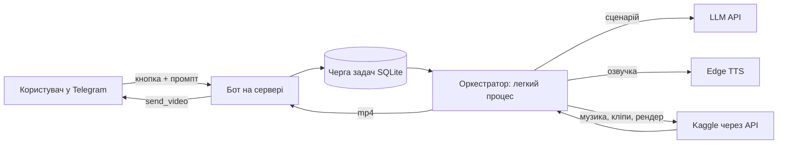

# Необов'язково: «одна кнопка» в Telegram-боті

Мета: у боті натискаєте «🎬 Відео», надсилаєте промпт, а за годину(и) у чат приходить готове відео. Схема:

## Принципи
- **Оркестратор легкий** (≤ 150 МБ RAM, окремий процес/юніт із `MemoryMax`), бот лише ставить задачі в чергу й показує прогрес
  (одне повідомлення, яке редагується: «Крок 3/7: музика…»).
- **Вимикач Kaggle** за замовчуванням вимкнений: задача чекає, поки власник дозволить (`/video_kaggle_on`). Захищає квоту GPU.
- **Dry-run** (`VIDEO_DRY_RUN=1`): заглушка-відео замість Kaggle — перевіряє весь шлях кнопка → результат у чаті без витрат.
- **Лише власник** (список дозволених chat id); без секретів у коді; логін Kaggle з конфігу сервера.
- Кроки сценарію й озвучки працюють на сервері (це запити до API), кліпи/музика/рендер — через `kaggle_job.py` і `clip_runner.py` із цього репозиторію.

Реалізацію для конкретного бота (модуль меню, черга, оркестратор, тести) автор тримає в окремому приватному репозиторії; перенесіть ці принципи у свій бот.
Затверджений сценарій і прев'ю озвучки варто підтверджувати кнопками ✅/✏️/❌ до запуску GPU.
